# Galaxy Watch Ultra2 — Concept Site

An interactive, scroll-driven product page for the Samsung Galaxy Watch Ultra2, built with Next.js, React Three Fiber and GSAP. The watch itself is modeled from scratch in code with three.js: no downloaded 3D files.

> Fan-made concept. Not affiliated with or endorsed by Samsung.

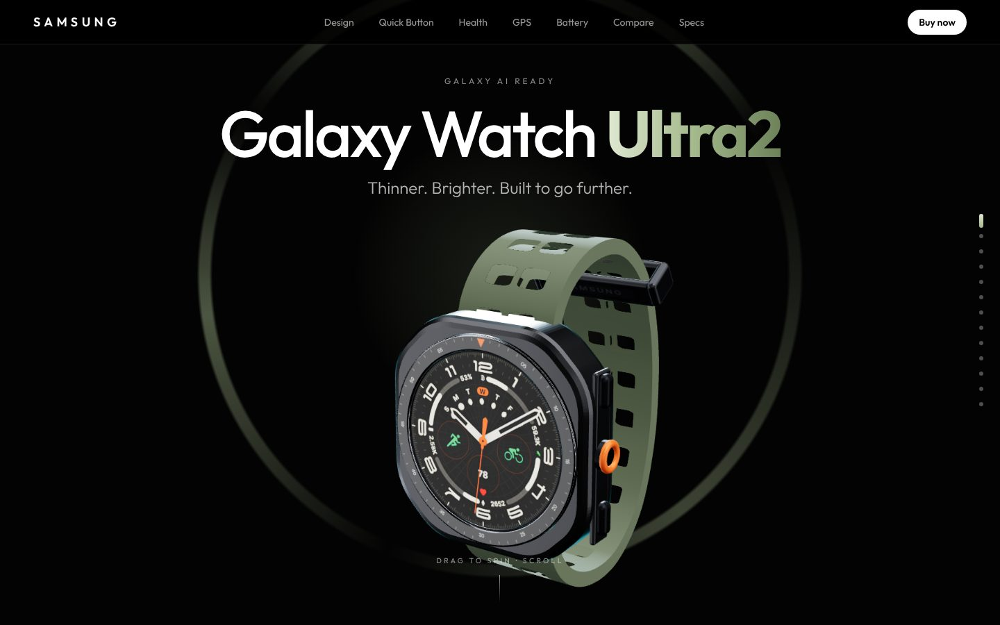

## Highlights

- **A watch built in code:** the slimmer titanium case, numbered bezel, sapphire display, reworked buttons, BioActive sensor, perforated Marine band and buckle are all generated procedurally with three.js (extrusions, custom ribbon geometry and canvas textures).
- **Scroll-driven 3D story:** one real-time model turns to show the titanium side and Quick Button, faces you for the display, then turns to its sensor while the band fades away.
- **Interactive hotspots:** labels pinned to the sapphire crystal, the Quick Button, the titanium case and the sensor that follow the model as it moves.
- **Night Mode:** switch the 3D watch face between day and the red night display.
- **Quick Button:** press the orange button to start a workout with a live timer, heart rate and distance. Press and hold to sound the emergency siren, synthesized with the Web Audio API.
- **Energy Score:** move sliders for sleep, activity and sleeping heart rate and watch the score and a live heart-rate trace react.
- **Dual-frequency GPS:** a simulated run through a city, recorded with L1 only or with L1 + L5, so you can see the track drift between tall buildings.
- **Built tough:** 10ATM, diving to 40 m, IP69K and materials in one switcher.
- **Battery:** rings for 80 h and 60 h that fill as you scroll, plus the 800 mAh cell and fast charging.
- **Colors:** Titanium Gray and Titanium Silver cases with five Sport Band colors (Black, Olive Green, Mocha, Orange, Blue). The band you pick also sets the accent color of the whole page and is remembered for your next visit.
- **Ultra2 vs Watch Ultra:** headline gains and a side-by-side spec table against the first Ultra.
- **Galaxy ecosystem:** links to its sister projects, the [Galaxy S26 Ultra](https://s27-ultra-concept.vercel.app) and [Galaxy Buds4 Pro](https://buds4-pro-concept.vercel.app) concept sites.

## Screenshots

| | |
|---|---|
| 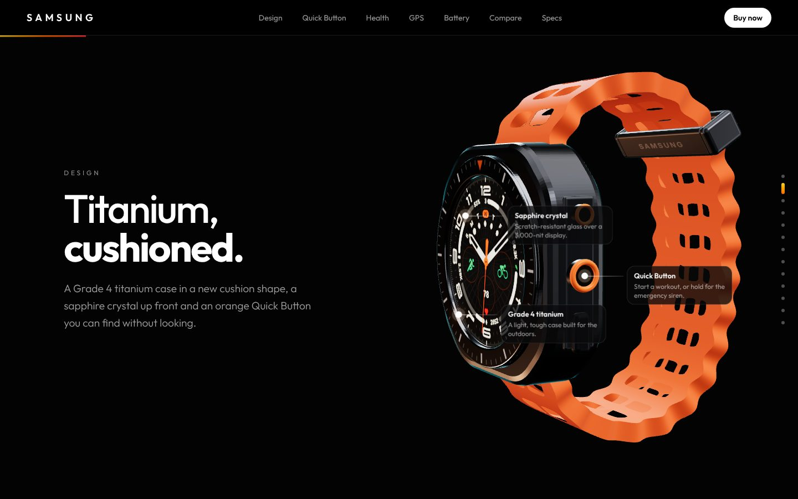 | 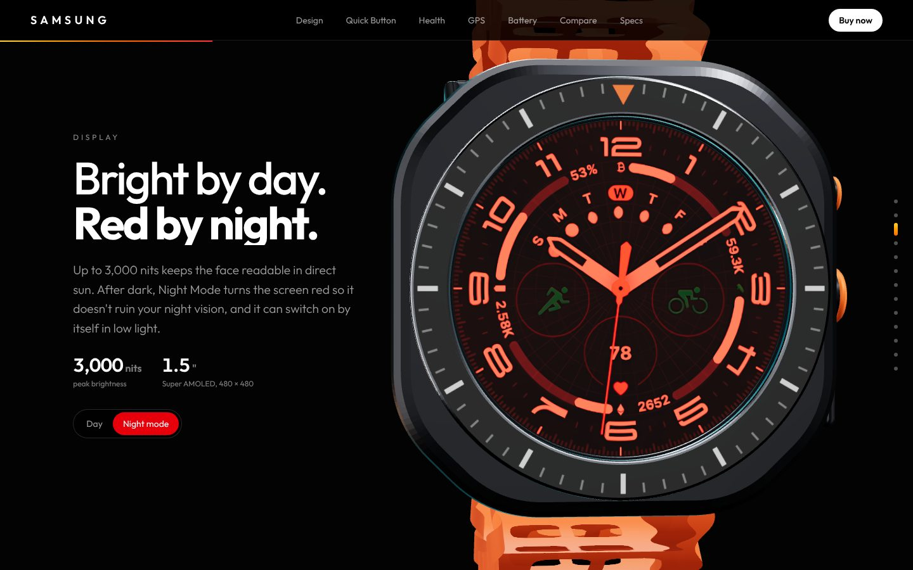 |
| **Titanium design** with hotspots | **Night Mode** on the 3D display |
| 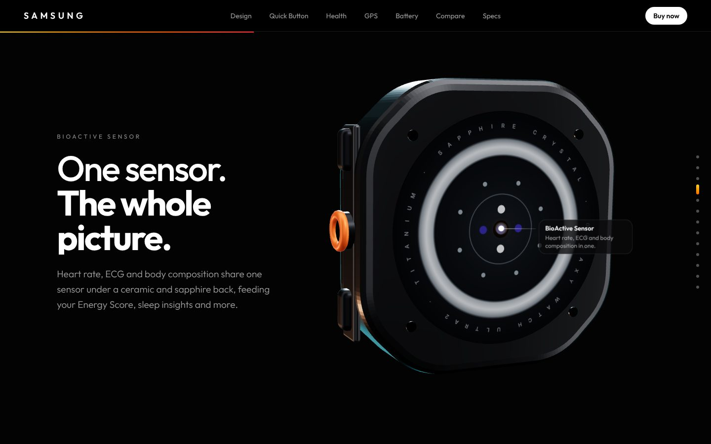 | 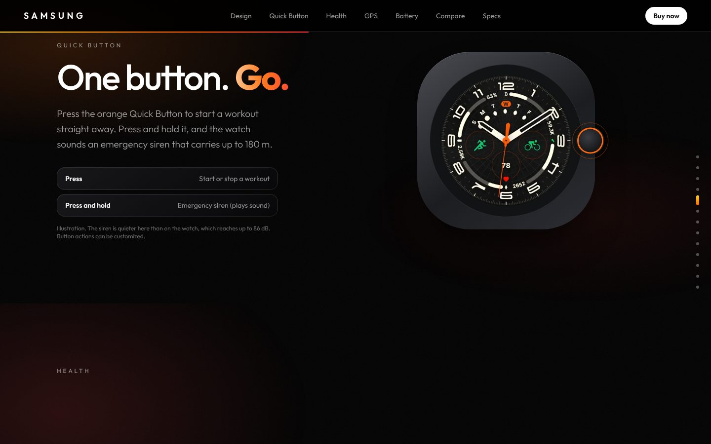 |
| **BioActive Sensor** on the back | **Quick Button:** workout or siren |
| 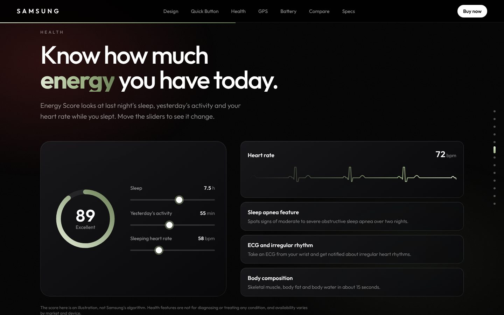 | 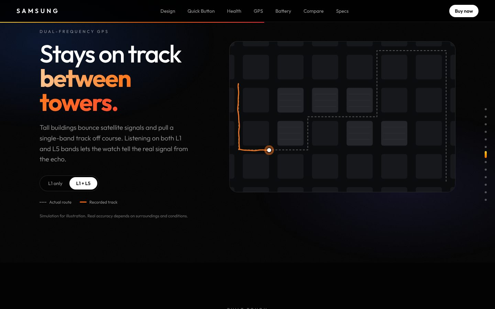 |
| **Energy Score** sliders | **L1 vs L1 + L5** GPS |
| 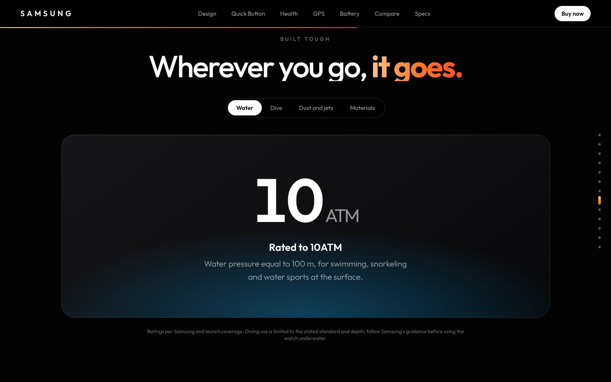 | 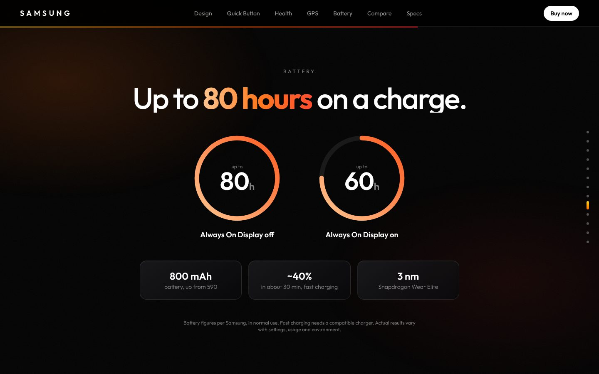 |
| **Built tough** | **Up to 80 hours** |
| 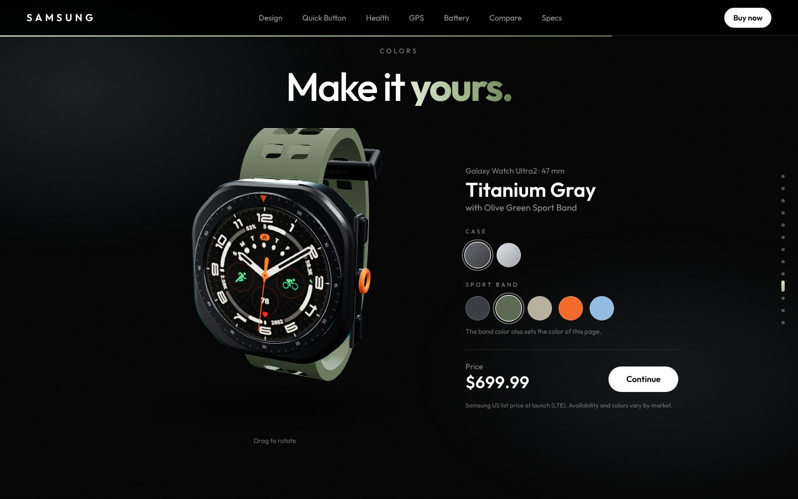 | 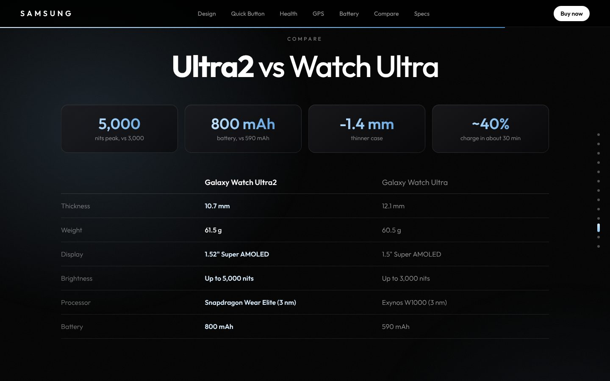 |
| **Colors** | **vs Galaxy Watch Ultra** |

### Mobile

| | | | |
|---|---|---|---|
| 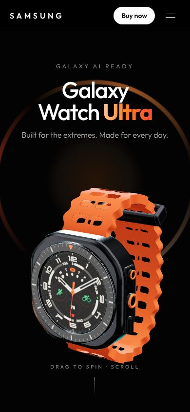 | 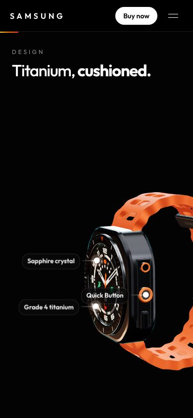 | 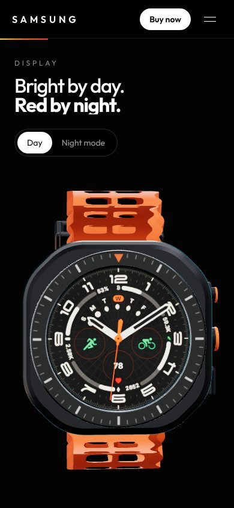 | 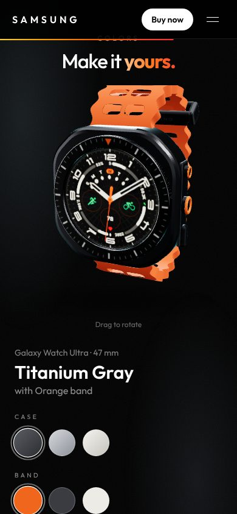 |

## Tech

- Next.js 16 (App Router, Turbopack), React 19, TypeScript, Tailwind CSS v4
- @react-three/fiber, @react-three/drei, three.js
- GSAP ScrollTrigger and Lenis for scroll
- Web Audio API for the siren, Canvas 2D for the heart-rate and GPS demos

## Run locally

```bash
npm install
npm run dev
```

Open http://localhost:3000.

## Credits

Designed and built by Hasan Alp Güngör. Product names and specifications belong to Samsung; figures are from Samsung's public announcement and product pages.
